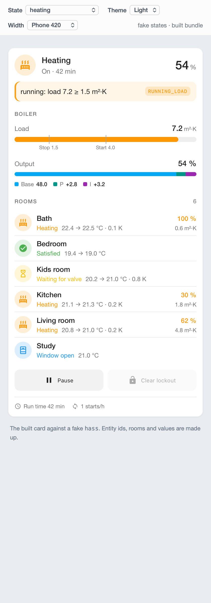
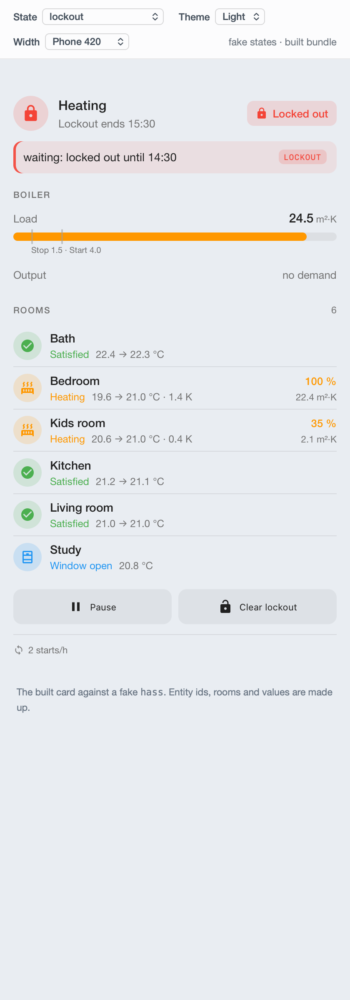

# Heating Controller Card

A dashboard card for the [`heating_controller`](https://github.com/gitgud187/heating-controller)
Home Assistant integration: what the boiler is doing, why, and what every room makes of it.



## What it shows

- **The boiler, with its reason.** The state (on, off, locked out, paused, unavailable) and the
  sentence the integration decided it with: `waiting: minimum off 5 min left`,
  `stopped: no room closer to target in 60 min (Bedroom 1.4 → 1.4 K), locked out until 14:30`.
- **Load against its thresholds.** The area-weighted demand in m²·K, with the start and stop marks.
- **Output**, split into the base (heating curve), the proportional and the integral term.
- **Every room**: status, current and target temperature, how far below target it is, its share of
  the load and its valve position.
- **Problems**, the rooms and boiler states that want a human.
- **Two controls**: pause and clear lockout. Nothing else is controlled here; room targets stay with
  the normal thermostat cards.



## Install

Through HACS, as a custom repository of type **Dashboard**: add this repository, install it, and
reload the browser. HACS adds the resource.

Manually: copy `dist/heating-controller-card.js` to `config/www/`, add it as a JavaScript module
resource (`/local/heating-controller-card.js`), and reload.

## Use

Add the card to a dashboard. It finds the controller by itself, so no configuration is needed:

```yaml
type: custom:heating-controller-card
```

Running more than one controller, pick one by its device:

```yaml
type: custom:heating-controller-card
controller: 5f3c8b0e2b7a4c1e9d6a0b3c4d5e6f70
```

The visual editor offers the same setting.

## What it needs

The `heating_controller` integration (2026.11 or newer). Some things the card can show come from
attributes the integration adds to its entities:

| Entity             | Attribute                                   | Shown as                                    |
| ------------------ | ------------------------------------------- | ------------------------------------------- |
| load sensor        | `start_load_m2k`, `stop_load_m2k`           | the start and stop marks under the load bar |
| room status sensor | `current_temperature`, `target_temperature` | `20.8 → 21.0 °C`                            |
| room status sensor | `valve_position`                            | the percentage on the right of a room       |

Without them the card leaves those parts out; it never guesses and never fails because an entity is
missing or renamed.

## Development

```bash
npm install
npm run build     # dist/heating-controller-card.js
npm test          # vitest
npm run check     # lint, format, types, tests, build
```

`design/demo.html` renders the built card against a fake Home Assistant, so it can be looked at
without installing anything. Serve the repository (`npx serve .`) and open `/design/demo.html`.

The built bundle is committed: the Marketplace installs it as it is. CI fails when `dist/` differs
from the source.

## Licence

MIT
